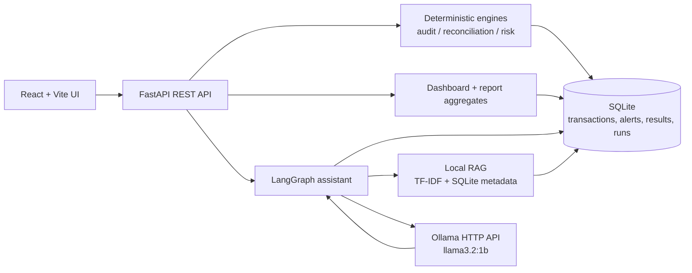
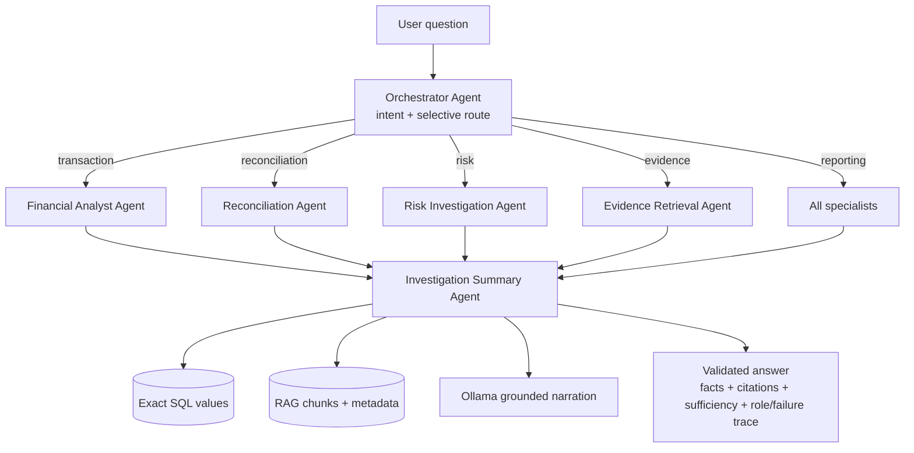
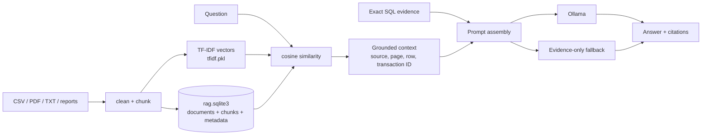

# FinAudit AI — Final Deliverables

This document records the completed local financial-intelligence platform, its architecture, user workflows, API surface, migration safety, verification results, limitations and local setup. Deployment configuration and a smoke-test checklist are in `DEPLOYMENT.md`; no live deployment has been published from this environment.

## 1. Scope of the completed work

The starter project was extended rather than rebuilt. Existing audit, invoice, risk and geospatial modules were preserved, while the following capabilities were added or completed:

- Database-backed Dashboard KPIs and five charts with documented calculation scope.
- Transaction preview, column mapping, validation, duplicate-safe import, filtering, detail view and source provenance.
- Deterministic bank/ledger reconciliation with matched, unmatched, amount/date mismatch and ambiguous results, plus human confirmation.
- Explainable deterministic risk alerts with an explicit review workflow.
- Selective five-role LangGraph assistant (Financial Analyst, Risk Investigation, Reconciliation, Evidence Retrieval, Investigation Summary) with validated outputs, SQL evidence, local RAG citations, per-agent failure tracing, persisted answer history and grounded Ollama narration.
- Lightweight local RAG over CSV, PDF, text reports and persisted investigation reports, with delete, re-index, per-document status and a retrieval-test endpoint.
- Alert-to-case investigation workspace with reviewers, notes, evidence, status/resolution, grounded AI explanations, history and CSV export.
- Filtered transaction and risk-alert CSV exports plus consolidated reports with generation time, applied filters and calculation provenance.
- Consolidated, secret-free system health endpoint reporting real DB/LLM/RAG/config status.
- Seven-item sidebar navigation; invoice tools remain available through internal Reports navigation.
- Additive SQLite schema reconciliation with automatic pre-migration backups, plus deployment configuration for Vercel + Render + Neon PostgreSQL.

## 2. System architecture



### Component responsibilities

| Layer | Files | Responsibility |
|---|---|---|
| UI | `frontend/src/main.jsx`, `Dashboard.jsx`, `Transactions.jsx`, `Assistant.jsx`, `workspace.css` | Seven-item workspace, imports, filters, review screens, citations, exports |
| API | `backend/app/main.py`, `risk_api.py`, `invoice_api.py` | REST endpoints, validation, upload limits, persistence and exports |
| Deterministic logic | `audit_engine.py`, `reconciliation.py`, `risk_engine.py`, `analytics.py`, `dashboard.py` | All amounts, scores, matches and counts |
| AI orchestration | `agents/assistant_graph.py`, `agents/orchestrator.py` | Selective routing, structured agent outputs, evidence assembly |
| RAG | `rag.py`, `vector_store.py` | Cleaning, chunking, local TF-IDF vectors, metadata and citations |
| Local LLM | `llm.py` | Ollama chat API, grounding rules, availability checks, safe fallback |
| Storage | `models.py`, `database.py`, `migrations.py` | SQLite models, additive migrations and backups |

No paid LLM or embedding API is used. The LLM is called only to narrate evidence already collected by deterministic SQL/rule code.

## 3. Screens and user workflows

### Sidebar

The primary sidebar contains exactly seven entries:

1. Dashboard
2. Transactions
3. Reconciliation
4. Risk Alerts
5. AI Assistant
6. Reports
7. Settings

Invoice Management, Purchase Orders, Goods Receipts, Invoice Matching, Discrepancies, Vendor Intelligence, Invoice Agent Center and Invoice Analytics remain available as secondary workspaces reached from **Reports → Additional workspaces / Invoice audit workspace**. This preserves the invoice functionality without expanding the primary navigation.

### Dashboard

`GET /api/dashboard/overview` returns:

- KPIs: total transactions, spending, received, net cash flow, matched/unmatched/possible matches, total/high/critical risk alerts.
- Five charts: `transaction_activity`, `spending_trends`, `risk_distribution`, `reconciliation_status`, `category_distribution`.
- Recent transactions and alerts with source-file/row references where stored.
- A `scope` object defining every KPI and chart. There are no hardcoded or placeholder figures.

### Transaction workflow

1. Open **Transactions** and upload one or more CSV files.
2. The API normalizes header aliases and returns a preview with column mapping, row count, errors, warnings and duplicate flags.
3. Click **Import**. With `skip_duplicates=true`, rows matching an existing `duplicate_key` or `(source_file, source_row)` provenance pair are skipped.
4. Search by text, date range, amount range, direction or source file.
5. Open a transaction to see its full record, linked risk alerts, reconciliation results, source file and source row.

The canonical CSV fields are `transaction_id`, `date`, `vendor`, `amount` and `description`; common aliases are normalized by `csv_normalizer.py`.

### Reconciliation workflow

1. Upload a bank statement CSV and a ledger CSV under **Reconciliation**.
2. `reconciliation.py` applies deterministic amount, date, reference and description matching.
3. Results are persisted with both sides of the evidence: dates, amounts, references, descriptions, source file/row, amount difference and day difference.
4. Ambiguous or unmatched results require a reviewer decision through `POST /api/reconciliations/results/{id}/confirm`; reviewer, timestamp and comment are saved.

Possible matches are never silently accepted as reconciled.

### Risk review workflow

1. Run deterministic analysis through **Risk Alerts** (`POST /api/risk/analyze`).
2. Alerts store an alert code, transaction ID, category, 0–100 score, severity, reason, amount, detection timestamp, source file in evidence JSON and review status.
3. Reviewers can assign, investigate, resolve, mark false positive or dismiss with comments. Stored statuses are `open`, `investigating`, `resolved`, `false_positive` and `dismissed`; the UI shows `investigating` as “Under investigation” and accepts “False positive”.
4. AI explanations cite the rule and source row; they do not change the score or status.

### Assistant workflow

1. Ask a question from the suggested prompts or enter a custom question.
2. The Orchestrator selects only the relevant specialist agents.
3. Specialists read exact values from SQL; Reporting searches the vector store and calls Ollama once with evidence-only instructions.
4. The response shows the route, agent timeline, answer, sufficiency, SQL evidence, document citations and deep links to transactions or alerts.
5. If evidence is insufficient or Ollama is offline, the app says so instead of inventing an answer.

### Reports workflow

**Reports** loads `/api/reports/summary`, showing financial scope, latest reconciliation, top alerts, investigation runs and grounded AI narratives with evidence references. Toolbar links export:

- `GET /api/reports/full.pdf` — summary, scope, alerts, AI explanations and evidence references, with generation time, filters and provenance.
- `GET /api/reports/full.csv` — transaction, alert and AI-explanation rows plus leading metadata rows for generated_at/filters/calculations.
- `GET /api/transactions/export.csv` and `GET /api/risk/alerts/export.csv` — filtered exports with `generated_at`, applied filters and provenance; plus audit, reconciliation and investigation case CSV exports.

## 4. Multi-agent design



| Role | Reads | Produces |
|---|---|---|
| Orchestrator Agent | Question keywords | Intent, selected route, route reason |
| Financial Analyst Agent | `transaction_records` | Vendor/amount/date facts, source row evidence, duplicate lead |
| Reconciliation Agent | `reconciliation_runs/results` | Counts, differences, exception rows, human-confirmation note |
| Risk Investigation Agent | `risk_alerts` | Rule, score, severity, explanation, transaction and source file |
| Evidence Retrieval Agent | RAG chunks | Grounded document citations with filename/chunk provenance |
| Investigation Summary Agent | Specialist outputs, retrieved evidence, Ollama | Narrative, citations, sufficiency, review disclaimer |

Routing is deterministic and selective: a risk question runs Risk + Summary, not every role. Each role returns a Pydantic-validated `AgentOutput` containing facts, hypotheses, missing evidence, recommendations and evidence. An individual role failure is captured in `agent_failures` and the timeline without hiding it; the summary role is the only node that calls the LLM, and grounding rules forbid invented IDs, amounts, dates or citations. Answers are persisted as `InvestigationRun(task_type="assistant_query")`. Legacy route keys (`transaction`, `reporting`) are preserved for compatibility, and the legacy ten-node invoice workflow and `MultiAgentOrchestrator` remain available for existing endpoints.

## 5. RAG architecture



- Ingestion endpoints accept up to 20 files of 5 MB each.
- CSV rows become row-level chunks with `source_row` and transaction ID metadata.
- PDFs use `pypdf` when available and a best-effort lightweight extractor otherwise.
- Repeated identical uploads are idempotent via a source-filename/content hash document ID.
- `rag.retrieve_context()` supplies policy snippets when no documents exist; these are explicitly labelled fallback review policies.
- Exact numeric answers always come from SQL, not vector similarity.

## 6. API reference

The full interactive schema is available at `http://127.0.0.1:8000/docs`. Primary endpoints:

| Method | Endpoint | Purpose |
|---|---|---|
| GET | `/api/health` | Backend health check |
| GET | `/api/dashboard/overview` | DB-backed KPIs, five charts, recent activity, scope |
| POST | `/api/transactions/preview` | Validate and preview CSV with mapping and duplicate flags |
| POST | `/api/audits` | Import CSV(s); supports `skip_duplicates` |
| GET | `/api/transactions` | Search/filter/paginate stored transactions |
| GET | `/api/transactions/{transaction_ref}` | Transaction detail, alerts and reconciliation evidence |
| POST | `/api/reconciliations` | Run bank/ledger reconciliation |
| GET | `/api/reconciliations`, `/{id}`, `/{id}/export.csv` | Read runs/results and export |
| POST | `/api/reconciliations/results/{id}/confirm` | Human confirm/reject with reviewer and comment |
| GET/POST | `/api/risk/config`, `/api/risk/analyze` | Risk configuration and deterministic analysis |
| GET/POST | `/api/risk/alerts`, `/api/risk/alerts/{id}/review` | Filter alerts and save review decisions |
| GET | `/api/risk/overview`, `/api/risk/channels`, `/api/risk/trends`, `/api/risk/geography*` | Risk analytics and stored-coordinate views |
| GET | `/api/transactions/export.csv`, `/api/risk/alerts/export.csv` | Filtered CSV exports with generated_at, filters and provenance |
| GET/POST/PATCH | `/api/investigations*`, `/api/cases` | Cases, from-alert, notes, evidence, explain, history, status/resolution and CSV export |
| POST | `/api/documents/ingest` | Ingest CSV/PDF/text documents into RAG |
| POST | `/api/documents/sync-transactions` | Index stored transactions into RAG |
| GET | `/api/documents`, `/api/documents/status`, `/api/documents/{id}/status` | RAG stats, document list and index status |
| DELETE | `/api/documents/{id}` | Delete a document and its chunks |
| POST | `/api/documents/reindex`, `/api/documents/retrieval-test` | Rebuild index; debug retrieval without the LLM |
| GET | `/api/assistant/suggestions`, `/api/assistant/config` | Suggested prompts and runtime configuration |
| POST | `/api/assistant/query` | Selective multi-agent grounded answer with role/failure trace and persisted history |
| GET | `/api/system/health` | Consolidated secret-free DB/LLM/RAG/config status from real probes |
| GET | `/api/reports/summary`, `/api/reports/full.csv`, `/api/reports/full.pdf` | Consolidated reports and exports with generation time, filters and provenance |
| POST | `/api/findings/{id}/explain` | Grounded explanation for an audit finding |
| POST/GET | `/api/agents/run`, `/api/agents/runs`, `/api/agents/runs/{id}` | Legacy persisted investigation workflow |
| POST/GET | `/api/vendors`, `/api/purchase-orders`, `/api/goods-receipts`, `/api/invoices*` | Invoice master data and ingestion |
| POST/GET | `/api/invoices/{id}/audit`, `/api/invoice-audits/run*`, `/api/invoice-audits/runs*` | Invoice audit workflow and exports |
| GET/POST | `/api/discrepancies*`, `/api/invoice-analytics/*` | Invoice exceptions, review and analytics |

## 7. Database safety and migrations

- A pre-change backup was created at `backend/data/backups/finaudit-pre-refactor-20261117-135303.db`.
- Startup calls `has_pending_schema_changes()` and, for file-backed SQLite, creates a timestamped online backup in `backend/data/backups/` before applying changes.
- `ensure_database_schema()` uses `metadata.create_all`, additive `ALTER TABLE ... ADD COLUMN` and `CREATE INDEX IF NOT EXISTS`. It never drops tables, columns or rows.
- A `NOT NULL` column without a server default is added as nullable with a warning, preserving existing rows.
- New reconciliation review fields (`review_status`, `reviewed_by`, `reviewed_at`, `reviewer_comment`) are additive.
- `false_positive` was added to risk review statuses while retaining legacy `dismissed`.
- Current startup schema report: `{'added_columns': [], 'created_indexes': [], 'warnings': []}` — no pending changes.
- Inputs are validated in endpoints: CSV extension/size/emptiness, 20-file ingestion limit, 1000-character question limit, decision enums and required reviewer names.

## 8. Verification

Commands were run from the repository root:

```bash
cd backend && python3 -m pytest -q
cd frontend && npm run build
```

Results after the final code changes:

- Backend: **125 passed**, 1 unrelated warning (`PytestRemovedIn10Warning` from `anyio/pytest_plugin.py`).
- Frontend: **production build succeeded** (Vite 8.3.5). Warnings only: lucide-react `"use client"` directive preservation and a bundle chunk larger than 500 kB.
- Targeted verification: management/RAG/roles **4 passed**, exports/mapping/investigation **6 passed**, deterministic end-to-end workflow **1 passed**.

Test modules: `test_agent_workflow.py`, `test_analytics.py`, `test_api.py`, `test_audit_engine.py`, `test_csv_normalizer.py`, `test_finaudit_platform.py`, `test_geo_api.py`, `test_investigation_api.py`, `test_invoice_audit.py`, `test_llm.py`, `test_management_api.py`, `test_reconciliation.py`, `test_risk_api.py`, `test_risk_engine.py`, `test_transaction_enrichment.py`, `test_exports_and_mapping.py`, `test_end_to_end_deterministic.py`.

`test_finaudit_platform.py` covers the Dashboard charts/scope, preview and duplicate prevention, RAG metadata retrieval, selective agent routing with citations, and reports/OpenAPI exposure. `test_end_to_end_deterministic.py` covers the full chain: import → reconciliation with independent mapping → deterministic risk alert → create case from alert → attach evidence/note → RAG ingest and retrieval test → five-role assistant with evidence-only fallback and persisted history → report summary, PDF/CSV, transaction/risk/case CSV exports. LLM tests verify local Ollama behavior and fallback rather than a hosted API key.

Run backend tests from `backend/` so `backend/tests/conftest.py` sets `FINAUDIT_DATABASE_URL` before the app is imported.

## 9. Known limitations

- Ollama is expected to be offline in this environment. Evidence-only fallback responses are normal and tested; install a local model for grounded narration.
- TF-IDF retrieval is lexical, not semantic. It is intentionally chosen for an 8 GB RAM laptop; no neural embedding model or ChromaDB is required.
- PDF extraction is best effort without `pypdf`; scanned/image-only PDFs are not OCR'd and must be reviewed manually.
- No authentication or multi-user access control exists. Run locally with synthetic or anonymized data; restrict any deployed instance at the network/edge layer.
- High-value and risk thresholds are configurable defaults, not universal accounting rules.
- Findings may overlap, so flagged amounts can double-count a transaction across rules.
- Currencies are never converted automatically; mismatches become review exceptions.
- Risk scores and AI narratives are investigation leads, not proof of fraud. No AI output approves a payment, resolves a case or authorizes a reconciliation adjustment.
- The report PDF is a text-based generated PDF, not a designed template.
- The frontend bundle is large because the existing invoice/geospatial workspaces remain in one build; code splitting is a future optimization.
- The RAG store is local SQLite on the backend filesystem; on ephemeral hosts, re-ingest documents after each deploy or mount persistent storage.
- Deployment configuration, secrets handling and a smoke-test checklist are documented in `DEPLOYMENT.md` (Vercel + Render + Neon PostgreSQL). No live deployment has been published from this environment; no deployed URLs are available.
- Multi-instance/horizontal scaling and authentication are not implemented; this is a single-instance prototype.

## 10. Local setup

### Prerequisites

- Python 3.11 or 3.12
- Node.js 20+
- Optional: Ollama with `llama3.2:1b` for AI narration
- Optional: `pypdf` is listed in `backend/requirements.txt`

### Backend

```bash
cd backend
python3 -m venv .venv          # use `py -m venv .venv` on Windows
source .venv/bin/activate      # Windows: .venv\Scripts\Activate.ps1
python -m pip install --upgrade pip
pip install -r requirements.txt
cp .env.example .env           # Windows: Copy-Item .env.example .env
uvicorn app.main:app --reload
```

Open `http://127.0.0.1:8000/docs`. On Windows/WSL, use a Linux-created virtual environment; the existing Windows-only `backend/.venv` cannot run under Linux.

### Ollama (optional)

```bash
ollama pull llama3.2:1b
ollama serve
```

`backend/.env` defaults to `OLLAMA_HOST=http://127.0.0.1:11434` and `OLLAMA_MODEL=llama3.2:1b`. If Ollama is unavailable, deterministic features still work and AI responses fall back to evidence-only text.

### Frontend

```bash
cd frontend
npm install
npm run dev
```

Open `http://localhost:5173`. Set `VITE_API_URL` in `frontend/.env` if the API is not at `http://127.0.0.1:8000`.

### Sample data

- `sample_data/transactions.csv` — includes a duplicate pair, a high-value payment and a negative amount.
- `sample_data/invoice_audit/` — import `vendors.csv`, `purchase_orders.csv`, `goods_receipts.csv`, then upload `invoices.csv` from the invoice workspace.
- `sample_data/synthetic/fictional_geo_transactions.csv` — synthetic geography example.

## 11. Key files

| Path | Purpose |
|---|---|
| `backend/app/main.py` | REST API, import preview/dedup, documents, assistant, reconciliation confirmation, reports |
| `backend/app/dashboard.py` | Database-backed KPIs, five charts and scope definitions |
| `backend/app/rag.py`, `vector_store.py` | Document ingestion, cleaning, chunking, local TF-IDF search and metadata |
| `backend/app/llm.py` | Local Ollama generation, grounding rules and fallback |
| `backend/app/agents/assistant_graph.py` | Selective five-role LangGraph workflow with failure trace and compatibility routes |
| `backend/app/investigation_api.py` | Investigation cases, from-alert, notes, evidence, explain, history and export |
| `backend/app/agents/orchestrator.py` | Legacy ten-node invoice/investigation workflow with Ollama support |
| `backend/app/migrations.py` | Additive migrations, backups and schema inspection |
| `backend/tests/test_finaudit_platform.py` | Platform tests (dashboard, import, RAG, routing, reports) |
| `backend/tests/test_end_to_end_deterministic.py` | Full import→reconcile→risk→case→evidence→RAG→assistant→report workflow |
| `backend/tests/test_management_api.py`, `test_exports_and_mapping.py`, `test_investigation_api.py` | Health/RAG/roles, exports/mapping and investigation workflow tests |
| `frontend/src/main.jsx` | Seven-item sidebar, routing and secondary workspaces |
| `frontend/src/Dashboard.jsx`, `Transactions.jsx`, `Assistant.jsx` | Core workspaces |
| `frontend/src/workspace.css` | Shared workspace/report styling |
| `README.md` | Quick-start entry point |
